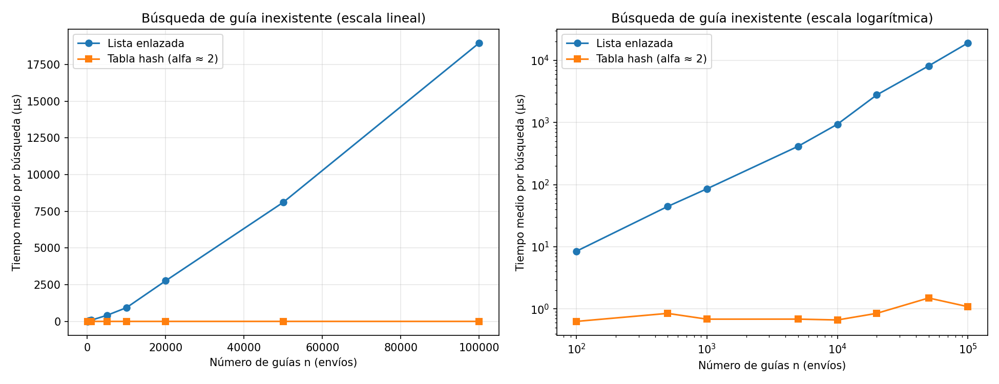
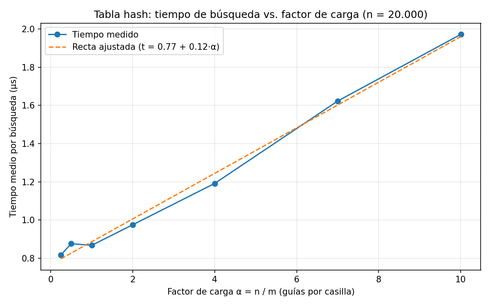

# Laboratorio evaluativo 03 - Estructuras de datos

**Nombre:** David Stiven Franco Lopez
**Caso:** Rutas del Caribe (empresa de mensajería)

## Instrucciones para reproducir el experimento

Se necesita Python 3.10 o superior (el código usa anotaciones como `str | None`) y Git. Todo se ejecuta desde la carpeta del laboratorio, con el entorno virtual de la raíz del repositorio activado.

**Windows (Git Bash)**, que es con lo que trabajé:
```bash
git clone https://github.com/Davdfranco/curso-analisis-algoritmos-DavidFranco.git
cd curso-analisis-algoritmos-DavidFranco
python -m venv venv
source venv/Scripts/activate
pip install -r requirements.txt
cd lab3-estructuras-datos
```

**macOS / Linux** (los comandos equivalentes; no los probé en esos sistemas):
```bash
git clone https://github.com/Davdfranco/curso-analisis-algoritmos-DavidFranco.git
cd curso-analisis-algoritmos-DavidFranco
python3 -m venv venv
source venv/bin/activate
pip install -r requirements.txt
cd lab3-estructuras-datos
```

Si el repositorio ya está clonado y el entorno ya existe, basta con activarlo: `source venv/Scripts/activate` en Git Bash, `source venv/bin/activate` en macOS/Linux, `venv\Scripts\activate` en el cmd de Windows o `venv\Scripts\Activate.ps1` en PowerShell.

Para ejecutar las pruebas (imprime *Todas las pruebas pasaron correctamente.*):
```bash
python pruebas.py
```

Para ejecutar las mediciones y regenerar las dos gráficas en `graficas/`:
```bash
python medicion.py
```

La medición puede tardar un par de minutos, casi todo por la lista con n = 100.000. Los tiempos cambian de un computador a otro (y de una ejecución a otra), pero la forma de las curvas debería ser la misma. Medí en Windows con Git Bash y matplotlib 3.10.9.

---

## Parte 1 - Implementar y verificar las dos estructuras

Código: [estructuras.py](estructuras.py) | [pruebas.py](pruebas.py)

`estructuras.py` tiene `Nodo`, `ListaEnlazada` y `TablaHash`. La lista inserta al inicio en Θ(1) y busca con un ciclo `while` (sin recursión). La tabla calcula la casilla con `guia % m`, reutiliza una `ListaEnlazada` en cada casilla y al buscar recorre solo la lista de esa casilla. No usé `dict`, `set` ni la función `hash()` de Python.

`pruebas.py` usa `assert` y cubre:

- Una búsqueda exitosa y una infructuosa en la lista y en la tabla, con la serie de ejemplo de cuatro guías.
- La colisión forzada: con m = 7, las guías 10, 24 y 17 caen en la casilla 3; las tres se insertan y se buscan después, la lista de esa casilla tiene longitud 3 y las otras seis casillas quedan vacías.
- `factor_carga()` da 3 / 7 después de esas tres inserciones.
- Veinte colecciones aleatorias (semilla 2026), con entre 1 y 400 guías y m en {7, 31, 101, 211}, donde lista y tabla devuelven lo mismo para todas las guías existentes y para 25 guías inexistentes por colección.
- Casos de borde: lista vacía, tabla de una sola casilla (m = 1) y que la inserción deje la última guía en la cabeza.

---

## Parte 2 - Medir y graficar

Código: [medicion.py](medicion.py)



La misma figura muestra las dos curvas en los mismos ejes, en escala lineal (izquierda) y logarítmica (derecha). En la lineal la tabla queda pegada al eje, porque cuesta microsegundos frente a milisegundos de la lista; por eso agregué la escala logarítmica y la tabla de valores de abajo.



La línea punteada es una recta ajustada por mínimos cuadrados a los siete puntos medidos; la puse para leer la tendencia, no como prueba de que la forma sea exactamente una recta.

### Cómo medí

- **Datos:** guías de diez dígitos, distintas, generadas con semilla fija (7). Las 200 guías inexistentes salen de la función `generar_guias_inexistentes` de la guía. Lista y tabla guardan las mismas guías y reciben las mismas búsquedas.
- **Experimento A:** n = 100, 500, 1.000, 5.000, 10.000, 20.000, 50.000 y 100.000. Para cada n, la tabla usa m primo cercano a n / 2, con α entre 1,99 y 2,13 (valores en la tabla de abajo). Se hacen 200 búsquedas de guías inexistentes.
- **Experimento B:** n = 20.000 fijo y m primo cercano a n / α para α = 0,25; 0,5; 1; 2; 4; 7 y 10. Como m debe ser primo, el factor de carga real, n / m, sale algo distinto del nominal (por ejemplo 10,005 en lugar de 10); el eje de la gráfica usa el real.
- **Cronómetro:** `time.perf_counter()` alrededor del ciclo de búsquedas. No se cronometran la construcción ni la generación de datos. Antes de medir, el programa comprueba que lista y tabla devuelvan el mismo estado para 200 guías existentes y `None` para las inexistentes.
- **Repeticiones:** cada tanda son las 200 búsquedas y el tiempo de una tanda es su promedio por búsqueda. La lista se mide con 15 tandas y se reporta la más rápida. La tabla se reconstruye en 7 rondas (insertando las guías en otro orden cada vez), se miden 51 tandas por ronda, se toma la más rápida de cada ronda y se reporta la mediana de las rondas. Elegí la tanda más rápida porque el ruido del computador solo suma tiempo.
- **Por qué tantas repeticiones:** con 5 repeticiones y la mediana, la curva del experimento B subía y bajaba. La misma tabla (n = 20.000, α = 2) dio 0,809 µs en el experimento A y 1,917 µs en el B. Por eso reconstruyo la tabla en varias rondas y repito más veces. No comprobé qué causaba esa diferencia.

### Valores medidos

Experimento A (tiempo medio por búsqueda de una guía inexistente):

| n | m | α | Lista enlazada (µs) | Tabla hash (µs) |
|---:|---:|---:|---:|---:|
| 100 | 47 | 2,13 | 8,5 | 0,632 |
| 500 | 251 | 1,99 | 44,5 | 0,850 |
| 1.000 | 499 | 2,00 | 85,6 | 0,686 |
| 5.000 | 2.503 | 2,00 | 413,7 | 0,687 |
| 10.000 | 4.999 | 2,00 | 936,7 | 0,666 |
| 20.000 | 10.007 | 2,00 | 2.767,8 | 0,851 |
| 50.000 | 24.989 | 2,00 | 8.111,6 | 1,503 |
| 100.000 | 49.999 | 2,00 | 18.965,8 | 1,090 |

Cuánto se multiplica el tiempo al pasar de un n al siguiente (calculado con la tabla de arriba):

| De n a n | n × | Lista × | Tabla × |
|---|---:|---:|---:|
| 100 → 500 | 5 | 5,24 | 1,34 |
| 500 → 1.000 | 2 | 1,92 | 0,81 |
| 1.000 → 5.000 | 5 | 4,83 | 1,00 |
| 5.000 → 10.000 | 2 | 2,26 | 0,97 |
| 10.000 → 20.000 | 2 | 2,95 | 1,28 |
| 20.000 → 50.000 | 2,5 | 2,93 | 1,77 |
| 50.000 → 100.000 | 2 | 2,34 | 0,73 |

Experimento B (n = 20.000):

| m | α | Tabla hash (µs) |
|---:|---:|---:|
| 79.999 | 0,250 | 0,818 |
| 40.009 | 0,500 | 0,876 |
| 19.997 | 1,000 | 0,868 |
| 10.007 | 1,999 | 0,975 |
| 4.999 | 4,001 | 1,192 |
| 2.857 | 7,000 | 1,623 |
| 1.999 | 10,005 | 1,972 |

**Qué tan confiables son los tiempos.** La misma tabla (n = 20.000, α ≈ 2) dio 0,851 µs en el experimento A y 0,975 µs en el B: cerca de un 15 % de diferencia entre dos ejecuciones equivalentes. Por eso no interpreto diferencias de ese tamaño en la tabla (por ejemplo, el empate entre α = 0,5 y α = 1). El 1,503 µs de n = 50.000 es más alto que el 1,090 µs de n = 100.000; si fuera un efecto real de n, el último tendría que ser mayor todavía, así que lo leo como ruido.

En la lista el tiempo por nodo (tiempo / n) se mantiene entre 0,083 y 0,094 µs hasta n = 10.000 y luego sube: 0,138 µs con n = 20.000, 0,162 µs con 50.000 y 0,190 µs con 100.000. Como se repite en tres tamaños seguidos, lo trato como un efecto real y no como ruido. Mi hipótesis, que no comprobé, es que a partir de ese tamaño los nodos ya no caben en la caché del procesador y cada salto de un nodo al siguiente cuesta más.

---

## Parte 3 - Análisis

### 1. Costo teórico

En la lista los envíos no están ordenados, así que para saber que una guía no existe reviso los n nodos: Θ(n).

En la tabla calculo la casilla con `guia % m`, que cuesta igual con cualquier n, y recorro solo la lista de esa casilla. Si las n guías se reparten parejo entre las m casillas, cada lista tiene en promedio n/m = α nodos. Una búsqueda infructuosa cuesta 1 (calcular la casilla) más α (recorrer la cadena): Θ(1 + α).

Eso depende de la dispersión uniforme: que la función hash mande cada guía a cualquier casilla con igual probabilidad, sin depender de las otras. Si todas cayeran en una sola, esa casilla tendría n nodos, las otras m − 1 estarían vacías y buscar costaría Θ(n): la tabla sería una lista.

### 2. Lo medido contra lo esperado

Si n se duplica, Θ(n) predice ×2 en la lista y Θ(1) predice ×1 en la tabla. De 5.000 a 10.000 la lista pasó de 413,7 a 936,7 µs (×2,26) y la tabla de 0,687 a 0,666 µs (×0,97). De 10.000 a 20.000 fueron ×2,95 y ×1,28 (todos los pares, en la Parte 2).

La lista sigue a Θ(n) con un poco de más: n creció 1.000 veces y el tiempo 2.231. El exceso viene del tiempo por nodo, que sube desde n = 20.000 (nota de la Parte 2). La tabla se multiplicó solo por 1,7 (0,632 a 1,090 µs), con subidas y bajadas que no crecen con n: coincide con Θ(1), con ruido.

En la segunda gráfica, con α de 0,25 a 10 el tiempo subió de 0,818 a 1,972 µs: α se multiplicó por 40 y el tiempo por 2,4. Con α = 0,5 y 1 hay empate (0,876 y 0,868). La recta ajustada es t = 0,77 + 0,12·α: 0,77 µs es la parte fija y 0,12 µs el costo de cada nodo extra de la cadena. Constante más proporcional a α es la forma de Θ(1 + α).

### 3. Colisiones

Una colisión ocurre cuando dos guías distintas dan la misma casilla. Pasa aunque sobren casillas porque hay muchas más guías posibles (diez dígitos) que casillas, y `% m` junta las guías que se diferencian en un múltiplo de m. Con m = 7, las guías 10, 24 y 17 dan 3: tres guías en siete casillas (α = 3/7) y chocan igual. En mis pruebas la casilla 3 queda con 3 nodos y las otras vacías.

El encadenamiento guarda una lista por casilla y las guías que chocan se agregan ahí. Ventajas: nunca se llena y admite α > 1 (llegué a 10). Costo: punteros extra y cadenas largas si α crece.

El direccionamiento abierto guarda todo en el arreglo y, si la casilla está ocupada, prueba otra. Con prueba lineal, la 10 va a la casilla 3, la 24 a la 4 y la 17 a la 5. Ventaja: sin punteros, menos memoria. Costo: exige α < 1, se degrada al llenarse y borrar es más complicado.

### 4. Tabla hash o árbol de búsqueda

Para "guías entre X y Y" la tabla hash no sirve: la función hash no respeta el orden, y dos guías consecutivas caen en casillas lejanas. Habría que revisar todas las casillas y envíos: Θ(n + m).

Un árbol de búsqueda guarda las guías ordenadas: se baja hasta X y se recorre en orden hasta pasar Y, a un costo de la altura más las k guías devueltas.

Si las 400.000 guías llegaran ordenadas, cada una iría a la derecha de la anterior y el árbol sería una lista: altura de 400.000, unas 200.000 comparaciones en promedio para buscar una guía que existe y unas 400.000 en el peor caso. Armarlo costaría ≈ 8 × 10¹⁰ comparaciones (n²/2). Uno equilibrado (AVL o rojinegro) tiene altura cercana a log₂(400.000) ≈ 18,6: unas 19 comparaciones, 21.000 veces menos, y armarlo costaría unos 7 millones.

### 5. Concepto para la jefa de operaciones

Recomiendo una combinación: tabla hash para las consultas puntuales del call center y árbol de búsqueda equilibrado, con la guía como clave, para los rangos. Gasta más memoria, pero cada una cubre lo que la otra no puede. Con 5.000.000 de envíos el árbol haría unas 22 comparaciones.

**Esto es una estimación, no una medición**, para buscar una guía inexistente entre 5.000.000 de envíos. La lista es Θ(n), pero el tiempo por nodo no fue constante: 0,085 µs hasta n = 10.000 y 0,19 µs en n = 100.000. Con 0,085 µs por nodo serían ≈ 0,43 s; con 0,19 µs, ≈ 0,95 s. Como ese costo venía subiendo y 5.000.000 es 50 veces mi n máximo, espero el valor alto: alrededor de 1 segundo, o más.

En la tabla supongo que m crece con n para mantener α ≈ 2, así que el costo sigue siendo Θ(1 + α), constante: medí entre 0,63 y 1,50 µs hasta n = 100.000. Estimo entre 1 y 2 µs, cientos de miles de veces menos que la lista. Si m no creciera, α crecería y volvería a ser Θ(n).
